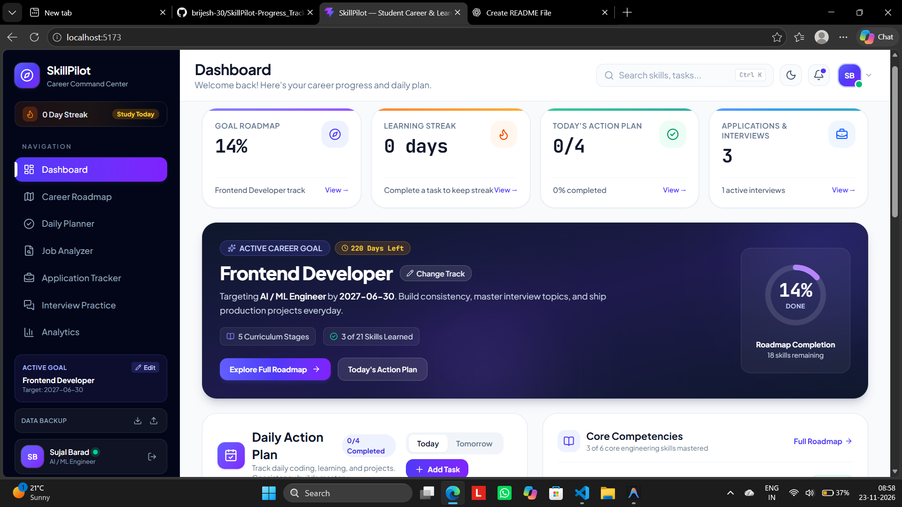
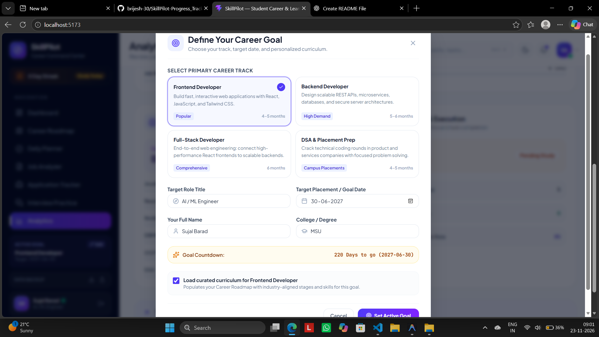
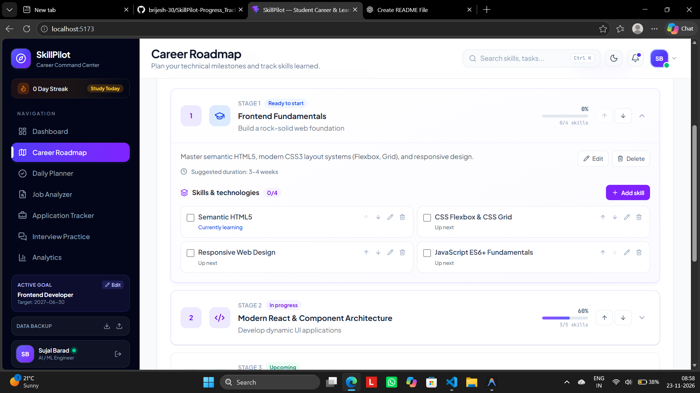
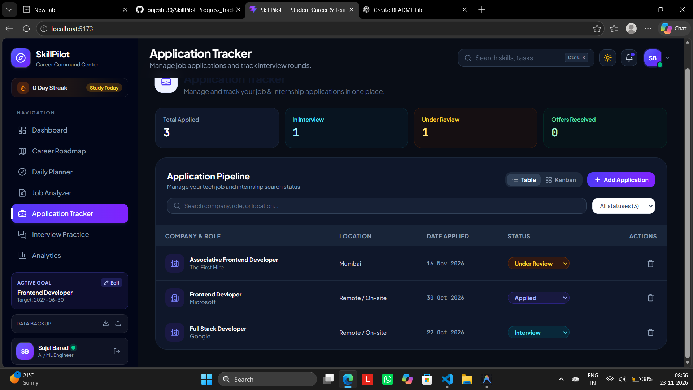

# SkillPilot — Career Command Center

**Plan your learning. Track your progress. Get career-ready.**

SkillPilot is a student-focused career planning dashboard that brings technical roadmaps, daily study goals, job-description analysis, interview practice, and job applications together in one place.

## Preview

<p align="center">
  
</p>

<details>
  <summary>Explore more screens</summary>
  <br />
  <p align="center">
    
    <br /><em>Set a target career track and placement goal</em>
  </p>
  <p align="center">
    
    <br /><em>Follow milestones and track skills</em>
  </p>
  <p align="center">
    
    <br /><em>Manage applications and interview stages</em>
  </p>
</details>

## Key Features

- **Personalized career roadmap** — Choose a target track, set a goal date, and follow staged milestones with skill-level progress.
- **Daily planner and streaks** — Prioritize tasks, set due dates, and track study consistency and time.
- **Job description analyzer** — Compare job requirements with your roadmap skills and identify learning gaps.
- **Application tracker** — Organize job and internship applications by status, with company and role details.
- **Interview practice** — Review curated JavaScript, React, system design, and DSA questions with answer reveals and confidence tracking.
- **Progress analytics** — Monitor roadmap readiness, learning activity, and application progress.
- **Built-in productivity tools** — Dark/light themes, `Ctrl + K` / `⌘ + K` command search, notifications, profile options, and JSON data import/export.

## Tech Stack

| Area | Technology |
|---|---|
| UI | React 19.3.1 |
| Build tool | Vite 8.3.4 |
| Styling | Tailwind CSS v4.3.5 |
| Icons | Lucide React 1.61.0 |
| Typography | Plus Jakarta Sans, JetBrains Mono |
| Linting | Oxlint 1.88.0 |
| Persistence | Browser `localStorage` + custom event bus |

## Run Locally

From the project directory, run:

```bash
npm install
npm run dev
```

Open the local URL printed by Vite in your browser. This assumes the project uses the standard Vite `dev` script.

## Data & Privacy

SkillPilot is designed as a client-side application. App data is stored in the browser using `localStorage`; use the built-in **JSON export/import** controls to back up or restore your data. Export a backup before clearing browser data or switching browsers/devices.

---

<p align="center">Built to make technical learning more structured and career preparation more manageable.</p>
